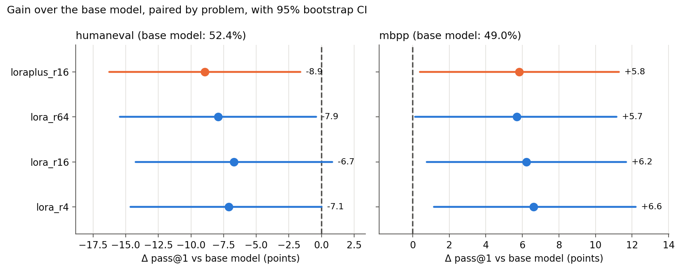
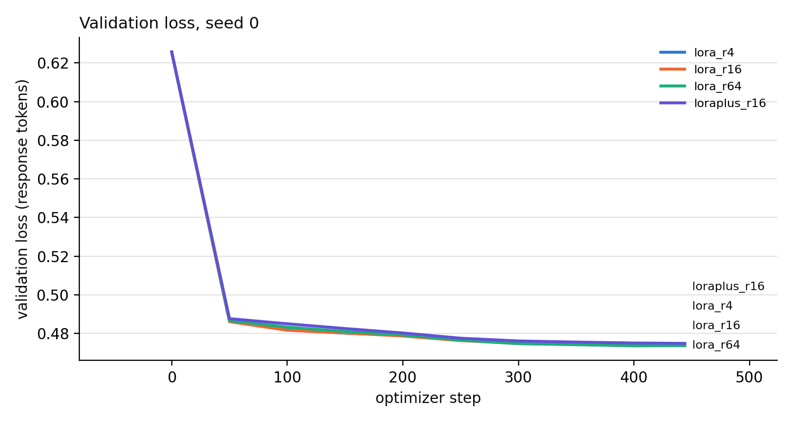

# Does LoRA rank matter for code generation?

[](https://github.com/SummmerKing/Lora-optimiser/actions/workflows/tests.yml)

A small, controlled experiment: fine-tune `Qwen2.5-1.5B-Instruct` on Python
instruction data with LoRA at ranks 4, 16 and 64, and with LoRA+, then check
whether any of it changes how many benchmark problems the model actually
solves. Scores are pass@1 from running the generated code against the unit
tests of HumanEval (164 problems) and MBPP-sanitized (257 problems), not
text overlap.

LoRA is implemented from scratch (no `peft`), and every fine-tuned config is
trained with 3 seeds.

## Results

| config | rank | α | B/A lr ratio | HumanEval | MBPP |
|---|---|---|---|---|---|
| base model | - | - | - | 52.4 | 49.0 |
| `lora_r4` | 4 | 8 | 1 | 45.3 ± 1.9 | 55.6 ± 0.4 |
| `lora_r16` | 16 | 32 | 1 | 45.7 ± 1.1 | 55.3 ± 1.0 |
| `lora_r64` | 64 | 128 | 1 | 44.5 ± 2.7 | 54.7 ± 1.0 |
| `loraplus_r16` | 16 | 32 | 16 | 43.5 ± 0.7 | 54.9 ± 0.0 |

pass@1 in %, mean over 3 seeds ± seed SD, greedy decoding. α = 2r everywhere,
so α/r is fixed and rank is the only thing that changes between the plain
LoRA rows. Full tables with CIs and p-values are in
[results/summary.md](results/summary.md).



What I take from this:

- **Rank doesn't matter here.** r4, r16 and r64 are within about a point of
  each other on both benchmarks, and none of the paired differences is close
  to significant (p > 0.45). r4 trains 4.6M parameters, r64 trains 74M.
- **LoRA+ doesn't help either.** It ties plain LoRA on MBPP and is 2.2 points
  lower on HumanEval (not significant after correction).
- **Fine-tuning moves the two benchmarks in opposite directions.** MBPP goes
  up about 6 points and HumanEval goes down 7-9 points. Uncorrected p-values
  are 0.02-0.09, but none survive Holm correction across the 7 comparisons,
  so I'd call these suggestive. One plausible reason is that the training
  data looks more like MBPP (short "write a function that..." tasks) than
  HumanEval's docstring-completion format.
- Validation loss barely separates the configs either (below).



## How the comparison is set up

The point was to make the comparison fair, so a few things are done
deliberately:

- **Loss on response tokens only.** Prompt, chat-template and padding tokens
  get label `-100`. Prompt and response are tokenized separately so the
  prompt tokens match what the model sees at inference.
- **Token-level loss under gradient accumulation.** Each optimizer step
  divides by the number of response tokens in the whole accumulation window,
  not by a per-micro-batch mean.
- **Functional correctness.** Every response is executed against the
  benchmark's tests in a separate process with CPU, memory and time limits.
- **Decontamination.** Training examples sharing a 13-gram with any
  HumanEval/MBPP prompt or solution are dropped (1,514 of 18,612), along with
  examples whose code doesn't parse. 14,206 train / 500 val remain.
- **Same tuning budget for every config.** Each config picks its learning
  rate from its own 3-point grid by validation loss on short runs (0.3
  epochs), never by benchmark score. LoRA+ gets a lower grid because its B
  learning rate is 16x higher.
- **Paired statistics.** 95% CIs bootstrap over problems. Configs are
  compared problem by problem with a sign-flip permutation test, and
  p-values are Holm-corrected within each benchmark.
- **Same decoding everywhere.** Greedy, no repetition penalty. Batched
  generation is tested to give the same output as one prompt at a time.

Training: 1 epoch, effective batch 32 (8 x 4 accumulation), 444 steps,
cosine schedule with 3% warmup, dropout 0.05, LoRA on all attention and MLP
projections, base model in bf16 with fp32 adapters.

Selected learning rates (val loss at 0.3 epochs):

| config | grid | picked |
|---|---|---|
| `lora_r4` | 1e-4, 2e-4, 4e-4 | 4e-4 |
| `lora_r16` | 1e-4, 2e-4, 4e-4 | 2e-4 |
| `lora_r64` | 1e-4, 2e-4, 4e-4 | 1e-4 |
| `loraplus_r16` | 2.5e-5, 5e-5, 1e-4 | 2.5e-5 |

Three of the four picks are at the edge of their grid, so a wider sweep
might shift the numbers a little. The val-loss differences across the grid
are small (under 0.015) though, so I don't expect it to change the overall
picture.

## LoRA implementation

`src/lora_code/lora.py` wraps each targeted `nn.Linear`:

$$y = W_0 x + \frac{\alpha}{r} B A x, \qquad A \in \mathbb{R}^{r \times d_\text{in}},\; B \in \mathbb{R}^{d_\text{out} \times r}$$

B starts at zero, so training starts exactly at the base model. A uses the
same Kaiming-uniform init as `nn.Linear`. LoRA+ (Hayou et al., 2024) is just
a second optimizer param group with lr_B = 16 · lr_A.

The tests check the forward pass against the dense formula, identity at
init, the gradients of A and B against their closed forms, the parameter
count against Σ r(d_in + d_out), merge/unmerge, and the save/load round trip.

## Repository layout

```
configs/grid.json        model, dataset, configs, LR grids, training settings
src/lora_code/
    lora.py              LoRA layer, wrapping, merge, adapter save/load
    data.py              chat formatting, prompt masking, decontamination
    train.py             training loop
    optim.py             AdamW with LoRA+ param groups, warmup + cosine
    modeling.py          model loading and batched greedy generation
    benchmarks.py        HumanEval / MBPP prompts and test programs
    execution.py         running generated code with resource limits
    stats.py             bootstrap CIs, permutation test, Holm, pass@k
scripts/
    prepare_data.py      build data/train.jsonl and data/val.jsonl
    sweep_lr.py          LR sweep, writes runs/selected_lr.json
    train.py             train one config + seed
    evaluate.py          evaluate the base model or one run
    aggregate.py         tables and figures in results/
    run_all.sh           everything, one GPU
    run_parallel.py      everything, spread over several GPUs
notebooks/run_study.ipynb  the same pipeline for Colab or a local Jupyter
tests/                   CPU-only tests (pytest)
runs/                    per-run config and metrics (adapters not committed)
results/                 per-problem results, summary and figures
```

Every per-problem result is saved, including the raw model response and the
stderr of failed tests, so any number in the summary can be traced back to
individual problems.

## Running it

Needs Python 3.10+ and a CUDA GPU with about 30 GB free for training.

```bash
pip install -e ".[dev]"
pytest -q                                          # ~20 s on CPU
bash scripts/run_all.sh                            # one GPU
python scripts/run_parallel.py --gpus 0,1,2,3      # or several
```

Both scripts skip anything that already exists, so an interrupted run picks
up where it stopped. Timings on an RTX A6000: a sweep run takes ~6 min, a full
training run ~21 min and an evaluation ~3.5 min. On one GPU the whole study is
about 6-7 hours; on 8 GPUs with `run_parallel.py` it took 45 minutes.

Individual steps:

| step | command | output |
|---|---|---|
| data | `python scripts/prepare_data.py` | `data/` |
| LR sweep | `python scripts/sweep_lr.py` | `runs/sweep/`, `runs/selected_lr.json` |
| train | `python scripts/train.py --config lora_r16 --seed 0` | `runs/lora_r16/seed0/` |
| evaluate | `python scripts/evaluate.py --run runs/lora_r16/seed0` (or `--base`) | `results/lora_r16/seed0/` |
| aggregate | `python scripts/aggregate.py` | `results/summary.md`, `results/figures/` |


